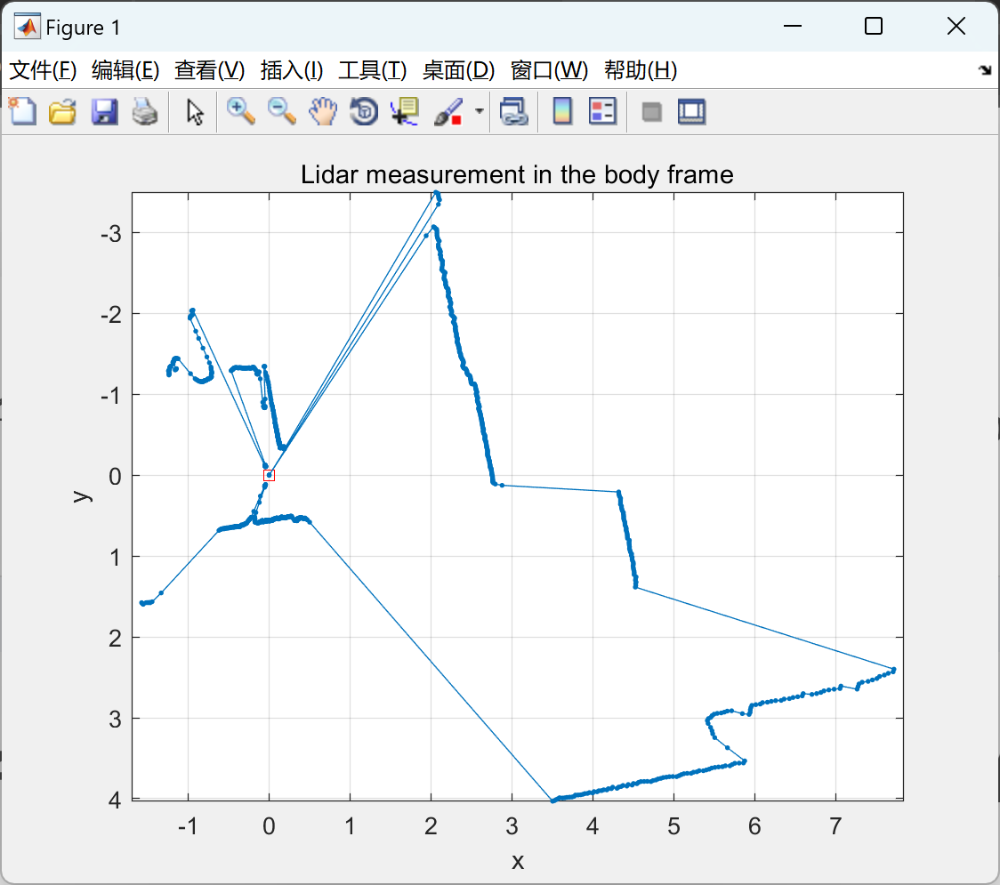
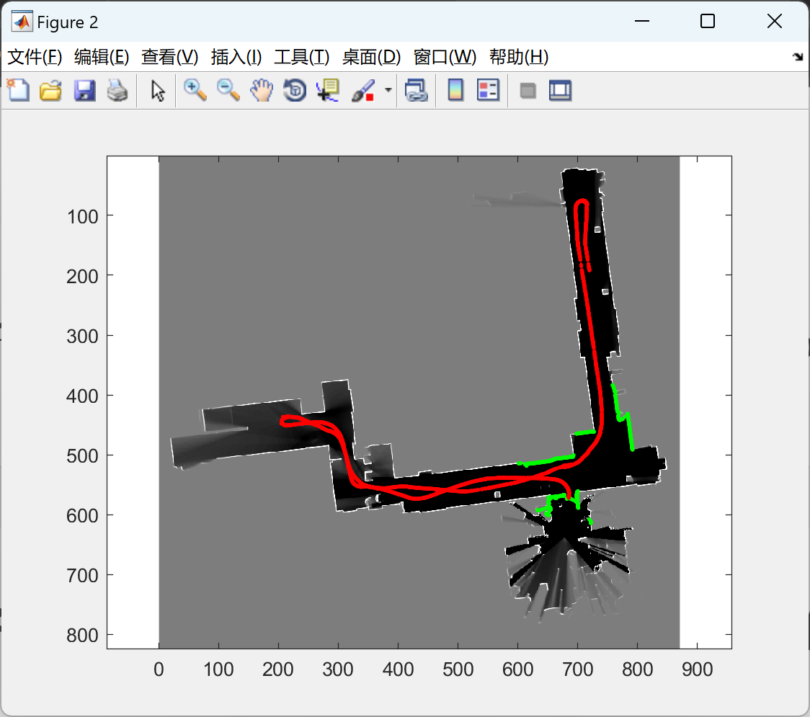

# Demo of two-dimensional lidar positioning based on particle filter (implemented in Matlab)

Demo of 2D Lidar positioning based on Particle Filter (Matlab code implementation)

Code execution results:
\n\n\n\n\nThis does not include Q&A. The .p file involves privacy, please do not shoot if you mind. Thank you.

## Images

<!-- PAYMENT_BLOCK -->

## Get this dataset

- Payment link (Stripe): [Buy now](https://buy.stripe.com/3cs8yP7sY87d0vu9AB)
- Payment QR code: 

<!-- /PAYMENT_BLOCK -->
